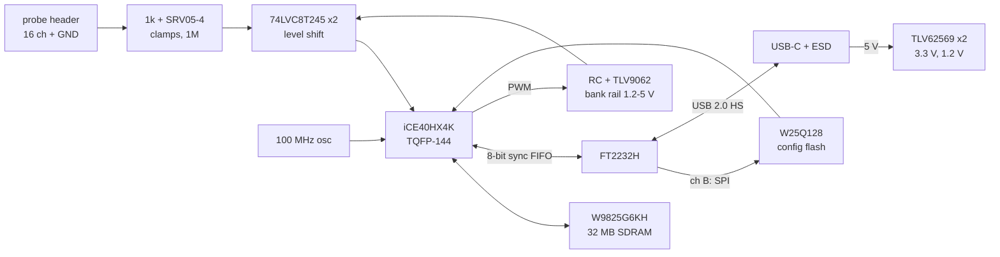

# VibePCB logic analyzer (work in progress)

A 16-channel USB 2.0 HS logic analyzer: an iCE40HX4K FPGA capturing into SDRAM, read out over an
FT2232H. Designed with [VibePCB](https://github.com/PaulBichl/vibepcb) (tscircuit -> KiCad) as a
stretch of the tooling: a 0.5 mm QFP FPGA, a length-checked memory bus, a 90 ohm differential pair,
power pads via-stitched to their planes. (A BGA version is a future topic, see `CLAUDE.md`.)

Status: `boards/la-main` passes `check` (KiCad DRC/ERC, house rules); review and SPICE of the input
front end are next.

## Target spec

| | |
|---|---|
| Channels | 16, two banks of 8, threshold per bank (I/O rail 1.2-5 V, threshold ~ rail / 2) |
| Sample rate | 100 MSa/s x 16 into SDRAM |
| Buffer | 32 MB (256 Mbit 16-bit SDR SDRAM) = 16 M samples x 16 ch |
| Streaming | ~40 MB/s over USB 2.0 HS (FT2232H sync FIFO): 16 ch at ~20 MSa/s |
| Inputs | 1 Mohm, 1k series + SRV05-4 clamps to the bank rail / GND |
| Probe | 2x10 2.54 mm header (16 signals + GND) |
| Power | USB-C 5 V, < 2.5 W |

## How it works

**Signal path.** A probe signal enters the 2x10 header, passes a 1k series resistor (with the
SRV05-4 clamping it to the bank rail and GND, and 1M pulling an open input low) and reaches a
74LVC8T245. Its A side runs on the bank rail, so the input threshold follows that rail (~ rail / 2);
its B side runs on 3.3 V and drives the FPGA. One translator per bank of 8 channels, so two target
logic families can be probed at once.

**Threshold.** The FPGA sets each bank rail itself: a PWM pin, a 10k / 1 uF RC filter, a TLV9062
op-amp with gain 1.5 -> 1.2 to 4.95 V. No DAC chip needed.

**Capture.** The FPGA samples all 16 inputs at 100 MHz (from the oscillator on a global clock pin),
runs the trigger logic and writes the samples to the SDRAM: 16 bit x 100 MSa/s = 200 MB/s, which
the 16-bit SDRAM (-6 grade, rated to 166 MHz) takes in bursts; 32 MB = 16 M samples (0.16 s at full
rate).

**Readout.** The FT2232H is the USB 2.0 high-speed interface: channel A is an 8-bit synchronous
FIFO to the FPGA (~40 MB/s), enough to read the buffer out or to stream 16 ch at ~20 MSa/s live.
Channel B (MPSSE) writes the FPGA bitstream into the W25Q128 SPI flash, which the FPGA loads at
power-up, so no separate programmer is needed. The 93LC56 EEPROM stores the FT2232H's FIFO-mode
setting.

**Power.** USB-C 5 V (5.1k CC pull-downs, no PD) -> two TLV62569 bucks: 3.3 V for I/O, SDRAM and
USB, 1.2 V for the FPGA core. Under 2.5 W.

**Why this FPGA.** The iCE40HX4K comes in a 0.5 mm TQFP-144: no BGA, so it routes on 4 layers and
can be hand-soldered or reworked (BGA is a later step for this project). It has enough I/O for 16
inputs + a 16-bit SDRAM bus + the FIFO, runs 100 MHz logic, and has a fully open toolchain
(yosys / nextpnr / icestorm). Its own block RAM (80 kbit)
would only hold ~5 k samples, hence the SDRAM. Downside: JLCPCB stock is low (36), check before
ordering.

Pins are assigned by package side so nothing crosses: inputs left, SDRAM right, FT2232H FIFO top,
config / PWM / LEDs bottom.

Stack-up (4 layers): top signals + GND / In1 GND / In2 3.3 V / bottom signals + GND. Net classes,
the USB pair, the SDRAM length groups and the via-stitched planes live in `boards/la-main/vibepcb.toml`.

## Parts (JLCPCB, stock checked 2026-10-15)

| Part | LCSC | Stock |
|------|------|-------|
| ICE40HX4K-TQ144 | C1521989 | 36 |
| W9825G6KH-6 | C62246 | 6.8k |
| FT2232HL | C27882 | 500 |
| SN74LVC8T245PWR | C27643 | 41k |
| W25Q128JVSIQ | C97521 | 55k (basic) |
| 93LC56BT-I/OT | C190271 | 9.2k |
| 100 MHz oscillator SX3M100.000B20F30TNN | C5179979 | 21k |
| TLV62569DBVR | C141836 | 416k |
| USBLC6-2SC6 | C7519 | stocked |
| SRV05-4 | C2836319 | 377k |
| TLV9062IDR | C398355 | 165k |

Out of scope for the board repo: FPGA gateware and the host software (a sigrok driver).
