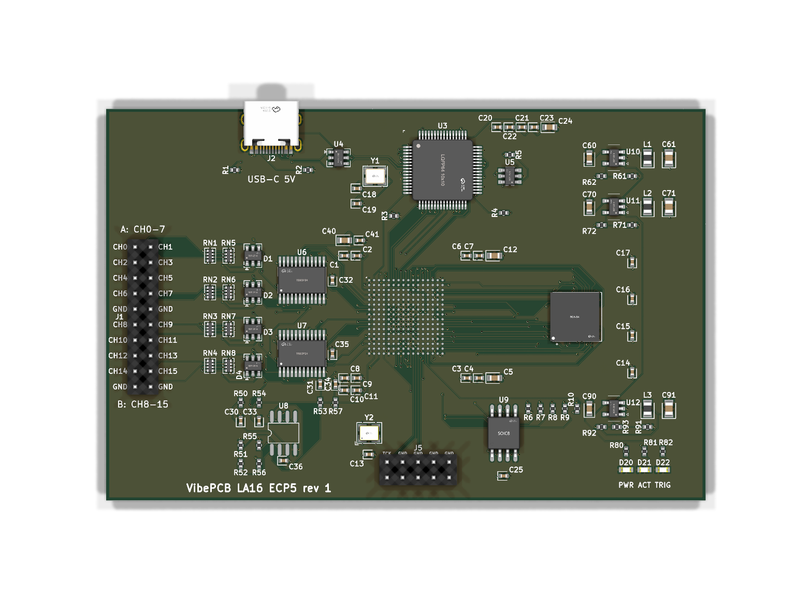

# VibePCB logic analyzer

A 16-channel, 100 MSa/s USB 2.0 HS logic analyzer: a **Lattice ECP5 FPGA (CABGA-256 BGA)**
capturing into a **32 MB SDRAM (54-ball BGA)**, read out over an **FT2232H**. 98 x 64 mm, 6 layers.
Designed with [VibePCB](https://github.com/PaulBichl/vibepcb) (tscircuit -> KiCad) as a stretch of
the tooling: two 0.8 mm BGAs escaped and routed by VibePCB's own router, a length-checked 39-signal
memory bus, a coupled 90 ohm USB pair, three power planes.

Status: passes `check` (KiCad DRC and ERC with 0 errors, house rules). Not fabricated yet.



## Look at it

| | |
|---|---|
| Schematic | [PDF](boards/la-ecp5/hardware/la-ecp5-schematic.pdf) |
| Layout | [PDF, one page per copper layer](boards/la-ecp5/hardware/la-ecp5-layout.pdf), [front](boards/la-ecp5/hardware/la-ecp5-layout-front.svg), [back](boards/la-ecp5/hardware/la-ecp5-layout-back.svg) |
| 3D | [top](boards/la-ecp5/hardware/la-ecp5-top.png), [bottom](boards/la-ecp5/hardware/la-ecp5-bottom.png) |
| BOM (LCSC / MPN) | [CSV](boards/la-ecp5/hardware/la-ecp5-bom.csv) |
| KiCad project | [kicad/](boards/la-ecp5/hardware/kicad) |
| Source | [index.circuit.tsx](boards/la-ecp5/index.circuit.tsx) (tscircuit), [vibepcb.toml](boards/la-ecp5/vibepcb.toml) (rules, planes, length groups, BGA escape), [routes.toml](boards/la-ecp5/routes.toml) (routing order) |

The KiCad project opens as it is. The 3D models are left out because they are tens of MB;
`pcb fix` downloads them. Gerbers and pick-and-place files are not in the repo: either plot them
from the KiCad project, or build the board (below) and run `hatch run pcb fab la-ecp5`, which
writes Gerbers, drill, BOM, CPL and a JLCPCB upload set.

## Target spec

| | |
|---|---|
| Channels | 16, two banks of 8, threshold per bank (I/O rail 1.2-5 V, threshold ~ rail / 2) |
| Sample rate | 100 MSa/s x 16 into SDRAM |
| Buffer | 32 MB (256 Mbit 16-bit SDR SDRAM) = 16 M samples x 16 ch |
| Streaming | ~40 MB/s over USB 2.0 HS (FT2232H sync FIFO): 16 ch at ~20 MSa/s |
| Inputs | 1 Mohm, 1k series + SRV05-4 clamps to the bank rail / GND |
| Probe | 2x10 2.54 mm header (16 signals + 4 GND), labelled per pin |
| Power | USB-C 5 V, < 3 W |
| Debug | JTAG header (J5), 3 LEDs (power, activity, trigger) |

## How it works

```
 probe     +--------------+    +---------------+    +-------------+
 header -->| 1k, 1M,      |--->| 74LVC8T245 x2 |--->|             |<--- 100 MHz osc
 16 ch     | SRV05-4      |    | level shift   |    |  ECP5-25F   |
           +--------------+    +---------------+    |  CABGA-256  |<==> IS42S16160J SDRAM
                  ^                    ^            |             |     (32 MB, BGA-54)
                  +--- bank rail ------+            |             |
                       1.2-5 V, x2                  |             |<--- JTAG (J5)
                          ^                         |             |
               TLV9062 + RC filter <------ PWM -----|             |
                                                    +--+-------+--+
                                                       ^       ^
                                    W25Q128 -----------+       | 8-bit sync FIFO
                                    config flash               v
                                       ^  SPI (ch B)     +---------+  USB 2.0 HS  +------------+
                                       +-----------------| FT2232H |<============>| USB-C, ESD |
                                                         +---------+              +-----+------+
                                                                                        | 5 V
                                           3.3 V, 1.1 V, 2.5 V <--- TLV62569 x3 <-------+
```

**Signal path.** A probe signal enters the 2x10 header, passes a 1k series resistor (with the
SRV05-4 clamping it to the bank rail and GND, and 1M pulling an open input low) and reaches a
74LVC8T245. Its A side runs on the bank rail, so the input threshold follows that rail (~ rail / 2);
its B side runs on 3.3 V and drives the FPGA. One translator per bank of 8 channels, so two target
logic families can be probed at once.

**Threshold.** The FPGA sets each bank rail itself: a PWM pin, a 10k / 1 uF RC filter, a TLV9062
op-amp with gain 1.5 -> 1.2 to 4.95 V. No DAC chip needed.

**Capture.** The FPGA samples all 16 inputs at 100 MHz (from the oscillator on a primary clock
input), runs the trigger logic and writes the samples to the SDRAM: 16 bit x 100 MSa/s = 200 MB/s,
which the 16-bit SDRAM (-7 grade, rated to 143 MHz) takes in bursts; 32 MB = 16 M samples (0.16 s at
full rate).

**Readout.** The FT2232H is the USB 2.0 high-speed interface: channel A is an 8-bit synchronous
FIFO to the FPGA (~40 MB/s, its 60 MHz CLKOUT on a primary clock input), enough to read the buffer
out or to stream 16 ch at ~20 MSa/s live. Channel B (MPSSE) writes the FPGA bitstream into the
W25Q128 SPI flash while it holds PROGRAMN low; the FPGA boots from it in master SPI mode
(CFG[2:0] = 010), so no separate programmer is needed. The 93LC56 EEPROM stores the FT2232H's
FIFO-mode setting.

**Power.** USB-C 5 V (5.1k CC pull-downs, no PD) -> three TLV62569 bucks: 3.3 V for I/O, SDRAM and
USB, 1.1 V for the FPGA core, 2.5 V for its aux supply. Under 3 W.

**Why this FPGA.** The ECP5 LFE5U-25F has 24k LUTs, 1 Mbit of block RAM and plenty of I/O for 16
inputs + the 39-signal SDRAM bus + the FIFO, with a fully open toolchain (yosys / nextpnr-ecp5 /
Project Trellis). Its block RAM alone would only hold ~60 k samples, hence the SDRAM. The CABGA-256
package was the point of the exercise: an earlier version of this board used an iCE40HX4K in a
TQFP-144 (4 layers, in git history) because tscircuit's router could not escape a BGA; VibePCB now
does the escape and routing itself.

## Layout

- **Stack-up (6 layers):** top signals + GND / In1 GND / In2 1.1 V core / In3 3.3 V IO /
  In4 GND / bottom signals + GND. Each power ball or pad gets its own via to its plane.
- **BGA escape:** both ball grids are escaped by VibePCB (0.1 mm tracks between the 0.36 mm balls
  at 0.8 mm pitch, dogbone vias 0.4 / 0.2 mm, mechanically drilled; deeper balls out on the
  bottom layer).
- **Planar pin plan:** FPGA pins are assigned by package side so no routes cross: inputs and the
  100 MHz clock west, SDRAM east, FT2232H FIFO north, configuration SPI south. Within a side, signals
  pair with balls by angle around both parts, so the routes nest instead of crossing.
- **SDRAM bus:** two length groups (data, address / control), skew <= 45 mm (~0.3 ns, ~10 % of
  the read window at 100 MHz), checked by KiCad.
- **USB:** a 90 ohm differential pair from the ESD part to the FT2232H, coupled over 7.3 mm with
  +0.09 mm skew.

Net classes, the USB pair, the length groups, the planes and the escape settings live in
[`boards/la-ecp5/vibepcb.toml`](boards/la-ecp5/vibepcb.toml); the routing order in
[`routes.toml`](boards/la-ecp5/routes.toml).

## Parts (JLCPCB / LCSC)

| Part | LCSC |
|------|------|
| LFE5U-25F-7BG256I (FPGA) | C1550762 |
| IS42S16160J-7BLI (SDRAM) | C1348766 |
| FT2232HL (USB) | C27882 |
| SN74LVC8T245PWR | C27643 |
| W25Q128JVSIQ (config flash) | C97521 |
| 93LC56BT-I/OT | C190271 |
| SX3M100.000B20F30TNN (100 MHz osc) | C5179979 |
| X322512MSB4SI (12 MHz crystal) | C9002 |
| TLV62569DBVR | C141836 |
| TLV9062IDR | C398355 |
| USBLC6-2SC6 | C7519 |
| SRV05-4 | C2836319 |
| TYPE-C-31-M-12 | C165948 |

Passives are in the [BOM](boards/la-ecp5/hardware/la-ecp5-bom.csv). Check stock before
ordering.

## Setup / build

Clone [`vibepcb`](https://github.com/PaulBichl/vibepcb) next to this repo as `VibePCB`, then

```bash
hatch run setup
hatch run pcb all la-ecp5       # build, fix, route, check
hatch run pcb publish la-ecp5   # refresh boards/la-ecp5/hardware/
hatch run pcb fab la-ecp5       # Gerbers, drill, BOM, CPL
```

`package.json` pins the tscircuit version the board was built with, because routing differs
between versions.

Out of scope for this repo: FPGA gateware and the host software (a sigrok driver).
